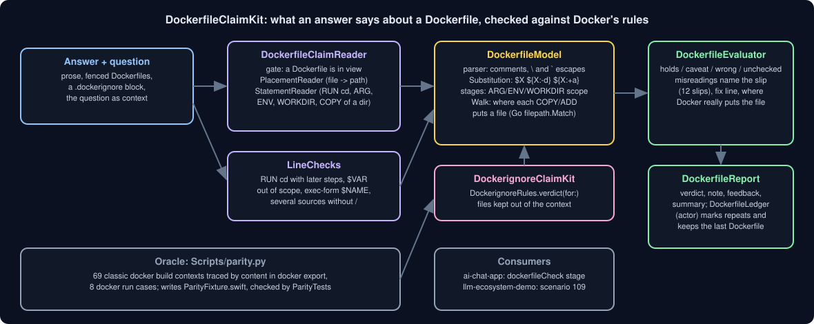
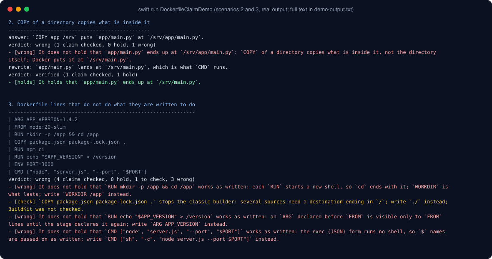
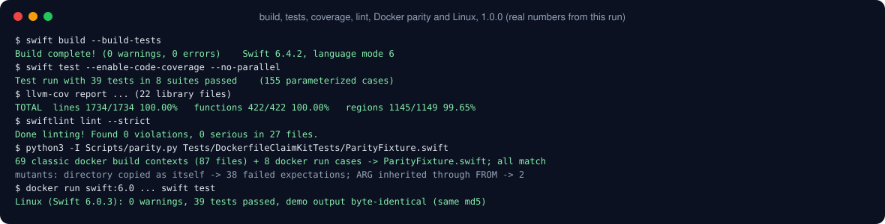

# DockerfileClaimKit



Ask a model for a Dockerfile and the explanation that comes with it is often where the mistakes are. It writes
`COPY src /app` and says `src/index.js` ends up at `/app/src/index.js` (Docker copies what is inside `src`, so it
lands at `/app/index.js`). It adds `RUN cd /app` so later steps run there (each `RUN` starts a new shell; the `cd`
ends with it). It declares `ARG APP_VERSION` above `FROM` and uses `$APP_VERSION` in a `RUN` (empty: the stage
never declared it again). It writes `CMD ["node", "server.js", "--port", "$PORT"]` (the exec form runs no shell, so
the server gets the text `$PORT`), or `COPY package.json package-lock.json .` (the classic builder stops: several
sources need a destination ending in `/`).

DockerfileClaimKit reads what an answer says about a Dockerfile, in its prose and in the Dockerfiles it shows, and
checks each claim against a model of how Docker reads the file: the parser (comments, continuation lines, the
`# escape=` directive, heredocs skipped), Docker's word processing (`$NAME`, `${NAME:-word}`, `${NAME:+word}`,
quotes, escapes), stages and what each one can see (`ARG` before `FROM`, `ENV` through `FROM`, `WORKDIR`), and
where every `COPY` and `ADD` puts a file (directories, patterns, trailing slashes, relative destinations,
`--from`, and the answer's `.dockerignore`). It says which claims hold, which are wrong, the mistake behind each
wrong one, and a line that does what the answer meant.

## Why

The series' claim checkers recompute what an answer works out on its own: dates, arithmetic, units, regexes,
strings, JSON, YAML, TOML, SQL, version ranges, `.gitignore` and `.dockerignore` rules. A Dockerfile is the next
file a coding answer writes, and its mistakes surface late: the image builds, the container starts, and the app
cannot find `/app/src/index.js`, or reads an empty `$APP_VERSION`, or listens on a port called `$PORT`. Most of
these come from reading the Dockerfile like a shell script or like `cp -r`, and Docker on this Mac is an exact
oracle for checking them.

## What it checks

| Kind | Example claim | What decides it |
|---|---|---|
| placement | "`src/index.js` ends up at `/app/src/index.js`" | where each `COPY`/`ADD` puts that file |
| placement, image path only | "you get `/app/src/src/index.js`" | the `COPY` source the path must come from |
| line | `RUN cd /app` with later steps, `$VAR` out of scope, exec-form `$PORT`, several sources to `.` | the line itself |
| `RUN cd` | "`RUN cd /app` makes the following commands run in `/app`" | each `RUN` is its own shell |
| `ARG` before `FROM` | "an `ARG` before `FROM` is available in every stage" | only `FROM` lines see it, unless redeclared |
| values across stages | "`ENV NODE_ENV` from the build stage is still set in the final stage" | `ENV` crosses only through `FROM`; `ARG` never |
| `ARG` at run time | "`ARG` values are available at runtime" | unless an `ENV` copies it |
| `WORKDIR` | "`WORKDIR /app` fails if the directory does not exist" | it creates it |
| `COPY` of a directory | "`COPY src /app` copies the folder itself" | what is inside is copied |

### The slips it names

`copiesDirectoryItself`, `globKeepsPath` (each match lands by its own name, without folders),
`workdirIgnored`, `destinationNotDirectory` (no trailing `/` and no directory there: the file is renamed),
`excludedByDockerignore`, `runCdDoesNotPersist`, `argBeforeFrom`, `stageStartsFresh`, `argIsBuildOnly`,
`workdirCreatesDirectory`, `destinationNeedsSlash`, `execFormNoShell`. A wrong placement is re-judged under each
misreading (a directory copied as itself, a pattern keeping folders, a destination read from `/`, a destination
read as a directory, the `.dockerignore` ignored, `ARG` values seen across `FROM`, values seen across stages); the
one that reproduces the claim names the slip. A placement no misreading explains is reported as unchecked, with
where Docker does put the file: the sentence may mean something else by that path.

### What the answer does not say

Some claims hold only under a setup the answer never states, and those are caveats, not wrong claims:

- A file copied to a path with no trailing `/` lands inside it only if the base image (or an earlier step) made
  that path a directory, and is renamed to it otherwise. A destination named like a file (`default.conf`, or the
  source's own name) is taken as a file.
- A relative destination in a stage built from an image depends on that image's `WORKDIR`.
- A pattern copied to a path without `/` makes that path the file only when it matches one file.
- `ENV` values reach a later stage only when it is built `FROM` the stage that sets them.
- Several sources copied to a destination without `/` stop the classic builder; BuildKit was not checked (see
  Limits), so with the builder unknown this is a caveat.

## Install

```swift
.package(url: "https://github.com/rajatslakhina/dockerfile-claim-kit.git", from: "1.0.0")
```

and `.product(name: "DockerfileClaimKit", package: "dockerfile-claim-kit")` in your target. Swift 6; it depends on
[DockerignoreClaimKit](https://github.com/rajatslakhina/dockerignore-claim-kit) for the `.dockerignore` rules.
macOS 13, iOS 16, tvOS 16, watchOS 9, and Linux.

## Usage

~~~swift
import DockerfileClaimKit

let answer = """
```dockerfile
FROM node:20-slim
WORKDIR /app
COPY src /app
RUN cd /app
CMD ["node", "$ENTRY"]
```

`src/index.js` ends up at `/app/src/index.js`.
"""
let report = DockerfileClaimChecker().check(answer)
report.verdict               // .wrong
report.summary               // "3 claims checked, 0 hold, 3 wrong"
report.note                  // "Dockerfile check: It does not hold that `RUN cd /app` works as written: ..."
report.feedback              // a re-prompt listing each correction
report.findings.compactMap(\.fix)  // ["WORKDIR /app", "CMD [\"sh\", \"-c\", \"node $ENTRY\"]"]
report.findings.last?.actual       // ["/app/index.js"]

// Where a file from the build context lands.
let model = DockerfileModel(Dockerfile("FROM scratch\nWORKDIR /srv\nCOPY src/*.js app/\n"))
model.placements(of: "src/a.js").paths      // ["/srv/app/a.js"]
model.placements(of: "src/lib/b.js").paths  // [] (`*` does not cross `/`)

// Nothing is read unless the answer or the question is about a Dockerfile.
let checker = DockerfileClaimChecker()
checker.check("`RUN cd /app` persists for the next steps.").verdict                          // .noClaims
checker.check("`RUN cd /app` persists for the next steps.", context: "My Dockerfile?").verdict  // .wrong

// Across a conversation, a wrong claim stated again is marked as repeated, judged against the last
// Dockerfile the conversation showed.
let ledger = DockerfileLedger()
_ = await ledger.review(answer)
let again = await ledger.review("Yes, `src/index.js` ends up at `/app/src/index.js`.")
again.repeatedCount  // 1
~~~

The example is a test (`ReadmeTests`).

### Policies

| Policy | Dockerfile lines as claims | Builder | Caveats |
|---|---|---|---|
| `.standard` | yes | unknown: what only the classic builder was seen to do is a caveat | reported |
| `.lenient` | no | unknown | let through |
| `.classic` | yes | the classic builder | reported |
| `.buildKit` | yes | BuildKit: what was not checked there is unchecked | reported |

## Only when a Dockerfile is in view

Nothing is read unless the answer, or the `context` a caller passes (the question), names a Dockerfile (or a
Containerfile) or shows one. Sentences about other copy tools (`cp -r`, `docker cp`, `rsync`, `kubectl cp`,
volumes and bind mounts, compose files, CI `env:`) make no claim, because their rules differ from `COPY`'s. A
sentence that names `.dockerignore` is left to DockerignoreClaimKit. When the conversation also talks about a
compose file, a Makefile, a workflow or an ignore file, only sentences that name the Dockerfile or one of its
instructions are read. Fifteen sentences from other domains (shell, SQL `FROM` and `ADD COLUMN`, regexes,
`git mv`, `.env` files) are kept as a test, and all make no claim.

## How it fits

- **ProviderGatewayKit** sends the turn; this package checks the answer that comes back. There is no compile-time
  dependency on it: run it on the reply text before the answer is shown.
- **DockerignoreClaimKit** decides what reaches the build context; this package asks it whether a file the answer
  says is copied was left out (`excludedByDockerignore`). Both read a sentence such as "`logs/a.log` ends up at
  `/app/logs/a.log`" when the `.dockerignore` excludes it; an app that runs both should show one note.
- **OutputRepairKit** runs a bounded repair loop; `report.feedback` is the re-prompt.
- **ai-chat-app** runs it as the `dockerfileCheck` stage after the model answers.

## Demo



`swift run DockerfileClaimDemo` runs eight scenarios: where each file of a Node build context lands, a directory
copy described as keeping its folder (wrong, then the rewrite), four Dockerfile lines that do not do what they are
written to do, general statements with no Dockerfile (wrong, then right), values and files across stages, a
`.dockerignore` keeping a file out of `COPY . .` (and what DockerignoreClaimKit says about the same sentence), the
same line under each builder policy, and a conversation through a `DockerfileLedger` where a wrong claim comes back
after an unrelated answer about a regex. The full output is in
[Screenshots/demo-output.txt](Screenshots/demo-output.txt); two runs are byte-identical, and so is the Linux run.

## Quality



- `swift build`: 0 warnings, 0 errors (Swift 6.4.2, language mode 6), tests included.
- `swift test --enable-code-coverage --no-parallel`: 39 tests in 8 suites (155 parameterized cases), 0 failures.
- `llvm-cov report`: **100.00% of lines (1734) and functions (422) on all 22 library files**; regions 99.65%
  (1145 of 1149). Per-file numbers are in [Screenshots/coverage.txt](Screenshots/coverage.txt).
- `swiftlint lint --strict`: 0 violations in 27 files, with the series' `.swiftlint.yml` unchanged.
- **Parity with Docker.** `Scripts/parity.py` builds 69 throwaway contexts (87 files), runs the classic
  `docker build` (Docker 27.4.0, `FROM scratch`), traces every file back by its content in `docker export`, and
  writes `ParityFixture.swift`; 8 more cases build on an image with a shell and record what `docker run` prints.
  The contexts cover directory and file sources, trailing slashes on both sides, `.` and `..` destinations,
  patterns that match files and directories, `**` (one level, like `*`), `?` and classes, relative destinations
  with and without `WORKDIR`, JSON form, sources outside the context, the `.dockerignore`, `ARG` before `FROM`
  with and without redeclaring, `ENV` and `ARG` across stages and through `FROM`, `COPY --from` by name and index,
  `${NAME:-word}` and `${NAME:+word}`, escaped `$`, the older `ENV NAME value` form, `ENV A=1 B=$A`, quoted values,
  continuation lines with a comment inside, lowercase instructions and `# escape=`. Four of them make the build
  stop, and all four are foreseen. The runtime cases confirm that `RUN cd` does not carry, that an `ARG` before
  `FROM` is empty in `RUN` until redeclared, that an `ARG` is gone when the container runs unless an `ENV` copies
  it, and that exec-form `CMD` prints `$P` as written.
- **Mutation checks**, each killed by `swift test`'s exit status: a directory copied as itself (38 failed
  expectations), and `ARG` values inherited through `FROM` (2).
- **Probes before tagging**: 24 correct answers stay unflagged, 10 wrong ones are caught with the right slip, 15
  sentences from other domains and 4 other-tool sentences next to a Dockerfile make no claim, a question about a
  compose file keeps a sentence that does not name the Dockerfile out, and a later regex turn in the same
  conversation stays quiet. Ten of the 24 came from a review before tagging, which found seven correct answers the
  first version flagged (a file copied to `default.conf`, `ENV PATH=...:$PATH` in two stages, a path from a
  `pip install` clause paired with a copied file, a negated `ARG` sentence, "copies the folder itself" about
  `COPY src /app/src`, "the Dockerfile itself", `tini -- sh -c`); each was fixed and is kept as a test.
- **Linux**: `swift:6.0` (Swift 6.0.3): 0 warnings, 39 tests pass, demo output byte-identical.

## Limits

- Docker's behaviour was run with the classic builder only (no buildx where this was built). BuildKit's `COPY`
  conversion was read from source (`frontend/dockerfile/dockerfile2llb/convert_copy.go`): it copies a directory's
  contents too, and has no check for several sources without a trailing `/`. Whether BuildKit then copies or stops
  was not run, so that line is a caveat unless the policy names a builder.
- `**` in a `COPY` source is matched the classic way (one level, like `*`); with the builder unknown it is a caveat.
- Files a `RUN` step creates, moves or deletes are not followed; a claim about a file after a `RUN` that runs
  `mv`, `cp`, `rsync` or `rm` is unchecked. `ADD` of an archive (which it unpacks), `COPY --parents`,
  `COPY --exclude`, heredoc bodies, and `--from` an image outside the Dockerfile are not modelled.
- A value set only by `--build-arg` (an `ARG` without a default) is unknown; an `ARG` default is taken as its value.
  Base images are not looked inside: a stage built from one may have its own `ENV`, `WORKDIR` and directories, and
  claims that depend on them are caveats.
- Only code spans are read: "the src folder" in plain prose is not a path. A file and a path in different clauses,
  or with another code span between them, are not paired. "Goes to `/app`" for a file is not judged (into it, or
  renamed to it).
- `PATH`, `HOME` and the other variables every container has are never reported as out of scope.

## Part of a series

One of a set of Swift packages around
[ProviderGatewayKit](https://github.com/rajatslakhina/foundation-model-provider-gateway); the
[llm-ecosystem-demo](https://github.com/rajatslakhina/llm-ecosystem-demo) shows them working together, and
[ai-chat-app](https://github.com/rajatslakhina/ai-chat-app) runs them in a real chat client.

## License

MIT
